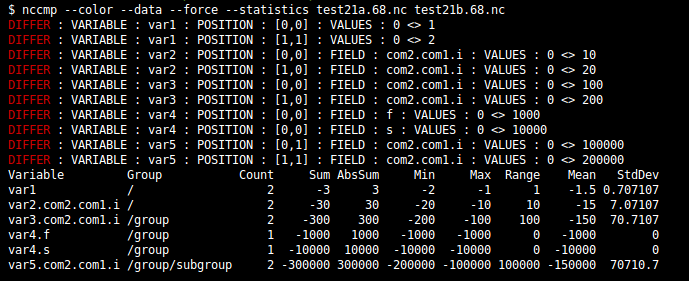

# nccmp - NetCDF Compare

## Overview

[nccmp](https://sourceforge.net/projects/nccmp) compares two NetCDF files bitwise, semantically or with a user defined tolerance (absolute or relative percentage).  Parallel comparisons are done in local memory without requiring temporary files.  Highly recommended for regression testing scientific models or datasets in a test-driven development environment.

Here's an incomplete list of reasons why you may want to check your data:

- Change in architecture (hardware, bare-metal, virtualization, platform, operating system).
- Change in compiler, compiler options or dependent libraries.
- Code refactoring, language migration, algorithm evolution, replacement or optimization.
- Data type promotion or demotion, compression, shuffling, alignment, ordering, encoding, metadata, or schema change.
- Process model change (framework, order of execution, partitioning).
- Tuning model parameters.
- Up/down-sampling fitness.

### Features

- Multi-threaded if posix threads are supported on your system.
- Prints differences and their locations (C or Fortran indexing). Format precision is customizable and allows hex.
- Specific variable inclusion or exclusion.
- Specific groups by short or full (absolute) names, or all (including recursive groups).
- Metadata and/or data comparisons.
- Global attributes compared with or without the history attribute.
- Exits when first difference is found or optionally continues to process all variables and/or attributes by force, or up to a global or per-variable count.
- Attribute exclusion when comparing metadata.
- Bitwise compare or with tolerances (absolute or relative).
- Header padding contents and attribute comparisons for NetCDF3 classic/64bit file formats.
- NaN values can be treated as equal (in case you use NaN's as grid masks).
- Compare or dump encodings for one or both files: checksumming, chunking, compression, endianness, format, shuffling, and header-pad sizes.
- Support all Netcdf4/HDF atomic types (char/text, schar, uchar, short, ushort, int, uint, int64, uint64, float, double, string) and user-defined types (enumeration, compound, opaque blob, variable-length array) and nesting.
- Compare asymmetric atomic data type values, within variable-length arrays too. For example, a variable can be uint in the first file, and int64 in the second.
- Compare similarly named compound fields and ignore differently named or missing fields, so compound schemas may have variation in field type, field order and field existence.
- Asymmetric enum value and datatype semantics. Enum identifiers are compared instead of their encoded values, so your dataset schema can evolve flexibly without worrying about enum order, size, type, or numeric values, although any metadata differences will be reported.
- Print data difference statistics (count, sum, absolute sum, min, max, range, mean, stdev) for numeric variables and compound fields. In quiet mode, only this summary table will print.
- Lightweight. Comparing multi-gigabyte files will only consume several megabytes of arena memory.

### Multithreading

Static scheduling is used for threads. Each thread will compare every time-varying variable
over thread-strided record indices. Threading is optional, and configure will determine if POSIX threads are available.

### Header Pad

If you do not use the classic NetCDF 3 format (the one that doesn't wrap HDF), than this section can be ignored.

What is a header pad? The classic format is organized into header and data sections. Only the data section can be appended to, such as adding new records (time steps) when resuming a simulation. This implies that any additional byte added to the metadata in the header requires copying over and rewriting the entire file. Some growing header operations include renaming to a longer variable name, or appending to the global attributes. To make such modifications in-place, you can pre-allocate the file's header to a larger size (100KB or more). This is often a technique used by large model runners to make post-processing more efficient.

In order to compare the contents and lengths of header pads, it is required to download the NetCDF
source code and configure nccmp using --with-netcdf=dir (Autotools) or -DWITH_NETCDF=dir (CMake) in order to access the private netcdf API. This is optional, and nccmp can be built without this feature.

## Download

### Binaries and Recipes

#### Multi-Platform

##### Conda

    conda install -c conda-forge nccmp
    
    # Alternative command if conda-forge is already in your list of channels.
    conda install nccmp

Courtesy of Klaus Zimmermann

##### Flatpak

    flatpak install nccmp

#### Ubuntu 12, 14, 15, 16

    sudo add-apt-repository ppa:remik-ziemlinski/nccmp && \
      sudo apt-get update && \
      sudo apt-get install nccmp

#### Windows

##### MSYS2

    wget https://downloads.sourceforge.net/project/nccmp/windows/x86_64/nccmp-1.8.2.0-msys2-x86_64.zip

##### Cygwin

Run either setup-x86.exe or setup-x86_64.exe, and select All => Science => nccmp.

#### Mac OSX

##### Homebrew

    brew tap remikz/nccmp https://gitlab.com/remikz/homebrew-nccmp.git
    brew install nccmp
    brew test nccmp

## Compiling

### Linux/Unix/MacPorts/Anaconda

(Optional) Download the NetCDF source code to support header-pad comparisons.

    cd /tmp && \
      wget -nd -c http://www.unidata.ucar.edu/downloads/netcdf/ftp/netcdf-4.5.0.tar.gz && \
      tar zxvf netcdf-*.tar.gz

#### CMake

    mkdir build
    cd build
    cmake \
      -DBUILD_TESTS=ON \
      -DCMAKE_BUILD_TYPE=Release \
      -DCMAKE_C_COMPILER=$GCC/bin/gcc \
      -DCMAKE_EXE_LINKER_FLAGS="-L$HDF/lib -lhdf5 -lhdf5_hl -L$NC/lib -lcurl" \
      -DCMAKE_INSTALL_PREFIX=path/to/install/dir \
      -DCMAKE_VERBOSE_MAKEFILE=OFF \
      -DNETCDF_INC_DIR=$NC/include \
      -DNETCDF_LIB_PATH=$NC/lib/libnetcdf.a \
      -DWITH_NETCDF=$NC/src \
      ..

    make -j
    ctest
    make install

#### Autotools

Specify non-standard installation locations for HDF and NetCDF,
if not auto-detected by configure (i.e. they're not in /usr/local/{include,lib}).

    HDF=/usr/local/hdf5-1.8.15-patch1
    NC=/usr/local/netcdf-4.3.3.1
    export CFLAGS="-I$HDF/include -I$NC/include"
    export LDFLAGS="-L$HDF/lib -L$NC/lib"
    tar zxvf nccmp-*.tgz && cd nccmp-*
    ./configure --with-netcdf=/tmp/netcdf-4.3.3.1 --enable-test-big

This will output:

    configure:

        CFLAGS             = -I/usr/local/hdf5-1.8.15-patch1/include -I/usr/local/netcdf-4.3.3.1/include -pthread
        CPPFLAGS           =
        enable-test-big    = yes
        HAVE_NC_H          = yes
        HAVE_NC_INQ_PATH   = yes
        HAVE_PTHREAD       = yes
        LDFLAGS            = -L/usr/local/hdf5-1.8.15-patch1/lib -L/usr/local/netcdf-4.3.3.1/lib -pthread
        LIBS               = -lnetcdf -lm
        with-netcdf        = /usr/local/netcdf-4.3.3.1/src

Proceed with compiling.

    make -j
    make check
    make install-strip
    make clean
    man nccmp

### Cygwin - Windows

Install these prebuilt binary cygwin packages via the setup GUI C:/cygwin/setup-x86.exe

    All => Libs  => libnetcdf7      v4.3.3.1-2
                 => libnetcdf-devel v4.3.3.1-2
                 => netcdf          v4.3.3.1-2

Proceed with compiling.

    ./configure --with-netcdf=/cygdrive/c/Temp/netcdf-4.3.3.1
    make
    make check
    make install

### MSYS2 - Windows

Get required packages.

    pacman -S make man gcc diffutils

Download and run Netcdf Windows installer:

    http://www.unidata.ucar.edu/software/netcdf/docs/winbin.html

Proceed with compiling.

    NC=/d/netCDF-4.3.3.1/
    export PATH=$PATH:$NC/bin
    ./configure CFLAGS=-I$NC/include LDFLAGS=-L$NC/bin --enable-test-big
    make
    make check
    make install

Check the result.

    man nccmp
    nccmp --version

    Configuration
    Date    = Wed Sep 30 13:48:00 EDT 2015
    Host    = MSYS_NT-6.1 rszhp 2.3.0(0.290/5/3) 2015-09-15 09:39 x86_64 Msys
    NetCDF  = 4.3.1-rc4 of Apr 13 2014 18:53:57 $
    User    = rsz
    Flags   = CC="gcc" \
              CFLAGS="-I/d/netCDF-4.3.3.1//include " \
              CPP="gcc -E" \
              CPPFLAGS="" \
              LDFLAGS="-L/d/netCDF-4.3.3.1//bin " \
              LIBS="-lnetcdf -lm " \
              ./configure CFLAGS=-I/d/netCDF-4.3.3.1//include LDFLAGS=-L/d/netCDF-4.3.3.1//bin --enable-test-big

### Mac OSX Homebrew

    brew tap homebrew/science
    brew install hdf5
    brew install netcdf

    NC=/usr/local/Cellar/netcdf/4.3.3.1_1
    export CFLAGS="-I$NC/include"
    export CPPFLAGS="$CFLAGS"
    export LDFLAGS="-L$NC/lib"
    export DYLD_LIBRARY_PATH="$DYLD_LIBRARY_PATH":$NC/lib

    ./configure --with-netcdf=/Users/rsz/source/netcdf-4.3.3.1
    make
    make check
    make install

## Testing

    $ cd build && ctest
    100% tests passed, 0 tests failed out of 76
    Total Test time (real) =  89.10 sec

Memory correctness is tested with valgrind. Leaks will print red colored errors.

    cd test
    ./memcheck.sh

## Examples

There are 68 examples in the test/ directory.

Compare metadata for non-record variables.

    $ nccmp -mf -x recdata,rec test1a.nc test1b.nc
    DIFFER : NUMBER OF DIMENSIONS IN FILES : 5 <> 4
    DIFFER : LENGTHS : DIMENSION : dim3 : 2 <> 1
    DIFFER : DIMENSION : dim4 : DOES NOT EXIST IN "test1b.nc"
    DIFFER : VARIABLE : data3 : DOES NOT EXIST IN "test1b.nc"
    DIFFER : DIMENSION NAMES FOR VARIABLE "data4" : dim4 <> dim2
    DIFFER : VARIABLE "data1" IS MISSING ATTRIBUTE WITH NAME "units" IN FILE "test1b.nc"
    DIFFER : LENGTHS : ATTRIBUTE : long_name : VARIABLE : data1 : 9 <> 10 : VALUES : "test data" : "test data_"
    DIFFER : VARIABLE : data1 : ATTRIBUTE : valid_range : VALUES : 1,2 <> -2,1
    DIFFER : NUMBER OF ATTRIBUTES : VARIABLE : data1 : 3 <> 2

Compare data using a tolerance threshold.

    $ nccmp -df -t 1e-3 test4a.nc test4b.nc
    DIFFER : VARIABLE : data1 : POSITION : [0,1] : VALUES : 2 <> 2.01 : PERCENT : 0.497512
    DIFFER : VARIABLE : data2 : POSITION : [0,1] : VALUES : 8 <> 7.99 : PERCENT : 0.125003
    DIFFER : VARIABLE : data3 : POSITION : [0] : VALUES : 9 <> 8 : PERCENT : 11.1111
    DIFFER : VARIABLE : data3 : POSITION : [1] : VALUES : 10 <> -10 : PERCENT : 200
    DIFFER : VARIABLE : data4 : POSITION : [0] : VALUES : 11 <> 110 : PERCENT : 90
    DIFFER : VARIABLE : recdata1 : POSITION : [0,1] : VALUES : 4 <> 0 : PERCENT : 100
    DIFFER : VARIABLE : recdata2 : POSITION : [0,0] : VALUES : a <> c : PERCENT : 2.0202
    DIFFER : VARIABLE : rec : POSITION : [1] : VALUES : 6 <> 6.1 : PERCENT : 1.63934

Compare data written in different formats (classic vs. HDF).

    $ nccmp -dmgfb test1a.nc test1c.nc
    2015-09-11 16:42:16.955951 -0400 INFO nccmp.c:135 Command-line options parsed.
    2015-09-11 16:42:16.955951 -0400 INFO nccmp.c:43 Opening input files.
    2015-09-11 16:42:16.955951 -0400 INFO nccmp_state.c:130 Opening test1a.nc
    2015-09-11 16:42:16.955951 -0400 INFO nccmp_state.c:130 Opening test1c.nc
    2015-09-11 16:42:16.955951 -0400 INFO nccmp.c:81 Comparing file formats.
    DIFFER : FILE FORMATS : NC_FORMAT_CLASSIC <> NC_FORMAT_NETCDF4
    2015-09-11 16:42:16.955951 -0400 INFO nccmp.c:95 Comparing groups.
    2015-09-11 16:42:16.955951 -0400 INFO nccmp_group.c:50 Comparing groups "/" and "/".
    2015-09-11 16:42:16.955951 -0400 INFO nccmp_metadata.c:1458 Comparing global attributes.
    2015-09-11 16:42:16.955951 -0400 INFO nccmp_group.c:60 Collecting dimension information for first group.
    2015-09-11 16:42:16.955951 -0400 INFO nccmp_group.c:67 Collecting dimension information for second group.
    2015-09-11 16:42:16.955951 -0400 INFO nccmp_group.c:74 Collecting variable information for group id = 65536.
    2015-09-11 16:42:16.955951 -0400 INFO nccmp_var.c:338 "rec" missing value: 0 (float)
    2015-09-11 16:42:16.955951 -0400 INFO nccmp_group.c:81 Found 6 variables in first group.
    2015-09-11 16:42:16.955951 -0400 INFO nccmp_group.c:82 Collecting variable information for group id = 131072.
    2015-09-11 16:42:16.955951 -0400 INFO nccmp_var.c:338 "rec" missing value: 0 (float)
    2015-09-11 16:42:16.955951 -0400 INFO nccmp_group.c:89 Found 6 variables in second group.
    2015-09-11 16:42:16.955951 -0400 INFO nccmp_var.c:173 Using all variables.
    2015-09-11 16:42:16.965951 -0400 INFO nccmp_var.c:182 Variables to compare (6): data1, data2, data3, data4, recdata, rec
    2015-09-11 16:42:16.965951 -0400 INFO nccmp_metadata.c:1800 Comparing record information.
    2015-09-11 16:42:16.965951 -0400 INFO nccmp_metadata.c:245 Comparing metadata.
    2015-09-11 16:42:16.965951 -0400 INFO nccmp_metadata.c:304 Comparing number of dimensions.
    2015-09-11 16:42:16.965951 -0400 INFO nccmp_metadata.c:1403 Getting record dimension names, if they exist.
    2015-09-11 16:42:16.965951 -0400 INFO nccmp_metadata.c:327 Comparing dimension lengths.
    2015-09-11 16:42:16.965951 -0400 INFO nccmp_metadata.c:930 Comparing user defined types.
    2015-09-11 16:42:16.965951 -0400 INFO nccmp_metadata.c:987 Comparing variable datatypes and rank.
    2015-09-11 16:42:16.965951 -0400 INFO nccmp_metadata.c:1054 Comparing variable dimension names.
    2015-09-11 16:42:16.965951 -0400 INFO nccmp_metadata.c:1120 Comparing variables attributes.
    2015-09-11 16:42:16.965951 -0400 INFO nccmp_data.c:3522 Comparing data.
    2015-09-11 16:42:16.965951 -0400 INFO nccmp_var.c:232 Validating variable data1.
    2015-09-11 16:42:16.965951 -0400 INFO nccmp_var.c:232 Validating variable data2.
    2015-09-11 16:42:16.965951 -0400 INFO nccmp_var.c:232 Validating variable data3.
    2015-09-11 16:42:16.965951 -0400 INFO nccmp_var.c:232 Validating variable data4.
    2015-09-11 16:42:16.965951 -0400 INFO nccmp_var.c:232 Validating variable recdata.
    2015-09-11 16:42:16.965951 -0400 INFO nccmp_var.c:232 Validating variable rec.
    2015-09-11 16:42:16.965951 -0400 INFO nccmp_data.c:3441 Thread 0 comparing non-record data for variable data1.
    2015-09-11 16:42:16.965951 -0400 INFO nccmp_data.c:3441 Thread 0 comparing non-record data for variable data2.
    2015-09-11 16:42:16.965951 -0400 INFO nccmp_data.c:3441 Thread 0 comparing non-record data for variable data3.
    2015-09-11 16:42:16.965951 -0400 INFO nccmp_data.c:3441 Thread 0 comparing non-record data for variable data4.
    2015-09-11 16:42:16.965951 -0400 INFO nccmp_data.c:3443 Thread 0 comparing data for variable recdata at record 0.
    2015-09-11 16:42:16.965951 -0400 INFO nccmp_data.c:3443 Thread 0 comparing data for variable recdata at record 1.
    2015-09-11 16:42:16.965951 -0400 INFO nccmp_data.c:3443 Thread 0 comparing data for variable rec at record 0.
    2015-09-11 16:42:16.965951 -0400 INFO nccmp_data.c:3443 Thread 0 comparing data for variable rec at record 1.
    2015-09-11 16:42:16.965951 -0400 INFO nccmp_data.c:3443 Thread 0 comparing data for variable rec at record 1.
    2015-09-11 16:42:16.965951 -0400 INFO nccmp_data.c:3552 Finished comparing data.
    2015-09-11 16:42:16.965951 -0400 INFO nccmp_group.c:126 Group comparison complete.
    2015-09-11 16:42:16.965951 -0400 INFO nccmp.c:108 Comparisons complete.

Compare identical files.

    $ nccmp -dmgfs test1a.nc test1a.nc
    Files "test1a.nc" and "test1a.nc" are identical.

Get some info on file structure internals.

    $ nccmp -i encoded.nc
    path=encoded.nc
    format=NC_FORMAT_NETCDF4
    header_size=0 bytes
    header_pad_size=0 bytes
    var=var1 checksum=NC_FLETCHER32 chunk=NC_CHUNKED chunksizes=[2] deflate=1 deflate_level=5 endian=NC_ENDIAN_BIG shuffle=1 szip_mask=0 szip_pixels_per_block=0

Compare opaque user defined type (3-byte blobs).

    $ nccmp -mdf test13a.nc test13b.nc
    DIFFER : TYPE : opaq2 : SIZE : 3 <> 4
    DIFFER : VARIABLE : var2 : POSITION : [1] : VALUES : 0x0A0B0C <> 0x0D0E0F
    DIFFER : VARIABLE : var3 : POSITION : [1,0] : VALUES : 0x000004 <> 0x040004
    DIFFER : VARIABLE : var3 : POSITION : [1,1] : VALUES : 0x000005 <> 0x000505
    DIFFER : VARIABLE : var3 : POSITION : [1,2] : VALUES : 0x000006 <> 0x000066

Compare nested compound field arrays of user types.

    $ nccmp -df make_compound_array_user_type1.nc make_compound_array_user_type2.nc
    DIFFER : VARIABLE : var1 : POSITION : [0,0,1,1,1,1,1] : FIELD : i : VALUES : 115 <> 215
    DIFFER : VARIABLE : var1 : POSITION : [0,0,1,1,0,1,1] : FIELD : myString : VALUES : bl <> cl
    DIFFER : VARIABLE : var1 : POSITION : [0,0,1,1,1,0,0] : FIELD : myEnum : VALUES : FOO <> BAR
    DIFFER : VARIABLE : var1 : POSITION : [0,0,0] : FIELD : myVlen[1,1,1,1] : VARIABLE LENGTH : 1 <> 2
    DIFFER : VARIABLE : var1 : POSITION : [0,0,0] : FIELD : myVlen[1,1,1,1][0] : VALUES : 16 <> 17
    DIFFER : VARIABLE : var1 : POSITION : [0,0,1] : FIELD : myComp[1,1,0,1].myLongLong[1,0,0,1] : VALUES : 1014009 <> 2014009

Print statistics and hide diff messages.

    $ nccmp -dfqS test21a.68.nc test21b.68.nc
    Variable         Group           Count     Sum AbsSum     Min     Max  Range    Mean   StdDev
    var1             /                   2      -3      3      -2      -1      1    -1.5 0.707107
    var2.com2.com1.i /                   2     -30     30     -20     -10     10     -15  7.07107
    var3.com2.com1.i /group              2    -300    300    -200    -100    100    -150  70.7107
    var4.f           /group              1   -1000   1000   -1000   -1000      0   -1000        0
    var4.s           /group              1  -10000  10000  -10000  -10000      0  -10000        0
    var5.com2.com1.i /group/subgroup     2 -300000 300000 -200000 -100000 100000 -150000  70710.7

## Usage

    Compare two NetCDF files.
    nccmp is silent when files are equivalent, otherwise it will echo to STDERR whether metadata or a specific variable differs.  By default, comparing stops after the first difference.

    Exit code 0 is returned for identical files, 1 for different files, and 2 for a fatal error.

    Usage: nccmp [OPTION...] file1 [file2]

      -A, --Attribute=att1[,...] Ignore attribute(s) att1[,...]
                                 for all variables.
      -b, --verbose              Print messages to show progress.
      -B, --buffer-entire-var    Load entire variable into memory
                                 to reduce memory allocation runtime overhead.
      -c, --var-diff-count=COUNT Stop comparing a variable after COUNT data diffs.
      -C, --diff-count=COUNT     Stop comparing after COUNT data diffs total.
      -d, --data                 Compare data (variable values).
      -D, --debug                Prints verbose debug messages.
      -e, --encoding             Compare these variable encoding settings:
                                 checksum, chunk, deflate, endianness, shuffle, szip
      -f, --force                Forcefully compare, do not stop after first
                                 difference.
      -F, --fortran              Print position indices using Fortran style
                                 (1-based reverse order).
      -g, --global               Compare global attributes.
                                 (auto enables -m)
      -G, --globalex att1[,...]  Exclude global attributes att1[,...].
                                 (auto enables -g)
      -h, --history              Compare global history attribute.
                                 (auto enables -g)
      -H, --help                 Give this usage message.
          --usage
      -i, --info                 Print file structure info for one or both files.
      -l, --color                Print colored messages.
      -m, --metadata             Compare metadata.
                                 Use -g to include global attributes.
      -M, --missing              Ignore difference between values that have
                                 different missing_value and/or _FillValue.
                                 Attribute differences are still reported.
      -n, --threads=N            Use N POSIX threads. Default is 1.
      -N, --nans-are-equal       Allow NaNs to be equal.
      -p, --precision=FMT        Global precision of difference printing.
                                 Use '%x' to print bytes.
                                 FMT defaults differently per data type:
                                     double '%g'
                                     float  '%g'
                                     int    '%d'
                                     int64  '%lld'
                                     schar  '0x%02X'
                                     short  '%d'
                                     text   '%c'
                                     uchar  '0x%02X'
                                     uint   '%d'
                                     uint64 '%llu'
                                     ushort '%d'
      -P, --header-pad           Compare header padding in classic or 64bit
                                 file formats.
      -q, --quiet                Do not print metadata or data differences.
      -r, --group=group1[,...]   Compare group(s) group1[,...].
                                 Group names can be full or short.
      -R, --no-subgroups         Do not compare nested groups.
      -s, --report-identical-files
                                 Report when files are the same.
      -S, --statistics           Report data difference statistics.
      -t, --tolerance=TOL        Compare if absolute difference > TOL.
      -T, --Tolerance=TOL        Compare if relative percent difference > TOL.
      -v, --variable=var1[,...]  Compare variable(s) var1[,...] only.
      -V, --version              Print program version.
      -x, --exclude=var1[,...]   Exclude variable(s) var1[,...].
      -w, --warn=tag[,...]       Selectively make certain differences
                                 exceptions, but still print messages.
                                 Supported tags and their meanings:
                                     all: All differences.
                                     format: File formats.
                                     eos: Extra attribute end-of-string nulls.
    
    Report bugs to https://gitlab.com/remikz/nccmp
    nccmp 1.9.0.0

    Configuration
    Date    = 18/07/21
    Host    = Linux-4.15.0-43-generic
    NetCDF  = 4.6.3 of Dec 14 2019 12:39:59 $
    User    =
    Flags   = CC="/usr/bin/cc" \
              CFLAGS="-I/home/rziemlinski/3ps/hdf5/include" \
              CPP="" \
              CPPFLAGS="" \
              LDFLAGS="-L/home/rziemlinski/3ps/hdf5/lib -lhdf5 -lhdf5_hl -L/home/rziemlinski/3ps/netcdf/netcdf-c-4.6.3/lib -lcurl -lnetcdf -lm" \
              LIBS="" \
              ./configure

    Features
    header-pad = yes
    pthreads   = yes

## News

Version 1.9.0.1 (7/20/2021)

1. Add missing tests to autoconf scripts.

Version 1.9.0.0 (7/18/2021)

1. Added new -R,--no-subgroups option.
2. Fixed comparing subgroups listed with -r.
   Reported by Edward Baudrez
3. Fixed bug with comparing number of subgroups.

Version 1.8.9.0 (12/31/2020)

1. Fixed bug where attributes of different lengths were not reported correctly.
   Reported by Dave Allured
2. Fixed duplicate symbol error with gcc10+.
   Fixed by Dave Allured

Version 1.8.8.0 (10/18/2020)

1. Print file name if not found.
   Reported by Verónica

Version 1.8.7.0 (4/18/2020)

1. Fixed bug that only found diffs with variable with/without a record dimension depending on input file order.
   Reported by Dave Allured

Version 1.8.6.5 (12/24/2019)

1. Added AppData content rating to fix flatpak build bot failure.

Version 1.8.6.4 (12/22/2019)

1. Added AppData component type to fix flatpak build bot failure.

Version 1.8.6.3 (12/21/2019)

1. Added AppData meta file for linux systems.

Version 1.8.6.2 (12/15/2019)

1. Fixed linking tests.
2. Install with Flatpak. Stop maintaining specific linux distro formats like deb/rpm for tools like apt, dpkg, dnf, yum, yast, pacman.

Version 1.8.6.1 (12/14/2019)

1. Updated contact email.
2. Added executable bit to installation script. 
   Reported by Ryan Schmidt.
3. Updated Homebrew release to use core tap instead of deprecated science. 
   Reported by T. Joe Mills.

Version 1.8.6.0 (12/8/2019)

1. Fix compiling by checking for NC_EFILTER, since it was introduced only after NetCDF 4.7.
2. Fix crash due to insufficient allocations for large number of subgroups.
   Thanks to Mark Dufour for reporting both items.

Version 1.8.5.0 (2/2/2019)

1. Updated szip API usage and tests to be compliant with NetCDF 4.6.2.
   Thanks to Tom Robinson for reporting failing tests.

Version 1.8.4.1 (1/14/2019)

1. Fixed positions printed for diffs when using -B flag.

Version 1.8.4.0 (1/13/2019)

1. Added a new flag "-B, --buffer-entire-var" to speed up runtime by many orders of magnitude for very tall
   variables that have vertical or record dimensions over tens of thousands in size.
   Thanks to Jennifer Adams (NASA) for reporting the issue.

Version 1.8.3.1 (6/27/2018)

1. Package scripts to configure with GNU Autotools as a classic alternative to CMake.

Version 1.8.3.0 (6/03/2018)

1. Fixed bug that did not report scalar variable diffs. Thanks to Laurence Beard (UK MetOffice) for spotting it.
 
Version 1.8.2.2 (12/24/2017)

1. Migrated project to Github. Thanks to David Meyer for the idea.
2. Updated CMake build scripts and tests to all pass with CTest.

Version 1.8.2.1 (2/21/2017)

1. Fixed compiler errors for newer GCC.
   Thanks to Jos de Kloe for providing a patch.

Version 1.8.2.0 (3/08/2016)

1. Add support for variables with no dimensions.
   Thanks to Matthew Hambley (UK MetOffice) for providing the data.

Version 1.8.1.0 (3/04/2016)

1. Refactored "fortran" variable names to "is_fortran" due to clash with C11 reserved keyword.
   Thanks to Matthew Hambley for pointing that out.

Version 1.8.0.0 (12/25/2015)

1. Added -S, --statistics to print summary data table for numeric data diffs.
2. Added -q, --quiet to suppress diff messages.
3. Added -l, --color for colored printing.
4. Added arena memory for non-compound numeric variables.
5. Added cmake config to build executable.

Version 1.7.5.1 (10/2/2015)

1. Allow compiling and testing in arbitrary build directory outside source
   directory tree to conform to Cygwin cygport build and check standards.

Version 1.7.5.0 (9/30/2015)

1. (MSYS Windows) Fix core dump from string-type deallocation and
   close test data file handles.
2. Replace config.guess with latest git version to support MSYS2.

Version 1.7.4.1 (9/29/2015)

1. Make build process parallel to conform to Homebrew build standards.

Version 1.7.4.0 (9/27/2015)

1. Updated code and tests to support 32-bit (i386) architecture on Ubuntu.
2. Created Ubuntu 12,14,15 PPAs.

Version 1.7.3.0 (9/25/2015)

1. Adapted code and tests to support older Netcdf 4.1.1 as found on Ubuntu 12.

Version 1.7.2.0 (9/24/2015)

1. Additional configuration info printed with --version.
2. Fixed bug with handling group dimensions for NetCDF libraries before version 4.3.
3. Make advanced NetCDF4 test data creation backwards compatible with ncgen before version 4.3.

Version 1.7.1 (9/21/2015)

1. Fixed bug in regression test and verified on Ubuntu 14 with Anaconda 2.3.0,
   thanks to Matt Savoie (NSIDC) for pointing out `make check` failures.

Version 1.7.0 (9/11/2015)

1. For HDF formatted files, compare variable encoding parameters for
   chunking, deflating, endianness, checksumming, shuffling and szip
   (-e, --encoding).
2. Support all new Netcdf4 atomic types:
   ubyte, ushort, uint, int64, uint64, string.
3. Support user-defined types and nesting of enums, compounds, variable-length, opaque blobs.
4. Asymmetric type data comparisons. For example, you can compare a
   variable defined as integer in the first file, and float in the second.
   Use --force if initial metadata variable type comparisons fail.
5. Enable optional big file test when running `make check`
   (./configure --enable-test-big).
6. Fixed segfault, all memory leaks and cleaned up scripts,
   thanks to testing by Emma Hogan (UK MetOffice).

Version 1.6.1 (7/29/2015)

1. Added multithreading with posix threads
   (-n, --threads=N).
2. Compare groups (and recursively) for all or by short or full name
   (-r, --group=group1[,...]).
   Thanks to Sean W. Bailey (NASA) and Rick Healy (NASA) for the idea and contributing code.
3. Dump file traits like shuffle, chunk, deflate, header-pad for one or
   both input files, with no need to do compare
   (-i, --info).
4. Limit comparisons and diff messages printed with global and/or per-variable count
   (-c, --var-diff-count=CNT, -C, --diff-count=CNT).
   Thanks to Sean W. Bailey (NASA) and Rick Healy (NASA) for the idea and contributing code.
5. Optionally build with header-pad and thread support, and print features enabled
   with --version or --help.

Version 1.5.0 (11/30/2014)

1. Added new -N, --nans-are-equal option.
   By default, NaN does not equal anything including itself.
   Now you can override this definition when comparing floats or doubles
   that might have NaNs.
   Thanks to Bob Fischer for this request.
2. Added new -P, --header-pad option.
   Some tools may alter the header pad after filtering classic/64bit NetCDF3 files.
   These changes can now be detected.
   Thanks to Andrew Wittenberg.

Version 1.4.0 (5/30/2013)

1. Added new -M,--missing option.
   If both files have different missing_value and/or _FillValue,
   consider them the same.  Thanks to Dave Allured for the idea.

Version 1.3.0 (4/4/2013)

1. Added new warning flag (-w eos) to ignore extra end-of-string nulls in (global and variable) attribute strings (NC_CHAR type).
2. Added missing support for -D debug flag.

Version 1.2.0 (2/23/2013)

1. Added configure option --enable-ncinfo (default is yes). This will build and install the small helper tool. Use --enable-ncinfo=no to skip it.
2. Added new option (-s, --report-identical-files) to report when two files are the same, just like "diff". Will print a string like:
Files "foo.nc" and "bar.nc" are identical.
3. Created git repo.

Version 1.1.2 (2/10/2013)

1. Fixed building for macports (MacOSX 10.8, Xcode 4.6, gcc4.7.2). Thanks to Dave Allured.

Version 1.1.1 (9/24/2012)

1. Bugfix to handle HDF group dimensions with dimids that don't start at zero. Thanks to Lynton Appel.
2. Removed default build and install of 'ncinfo' because not core to nccmp mission. If you still need it, cd into the ncinfo subdir and do make there.

Version 1.1.0 (7/15/2010)

1. Added "-w, --warn" command-line option to make certain differences exceptions and only print messages of their occurance.  Thanks to Aleksey Yakovlev.
2. Added a small helper program called 'ncinfo' that echoes a file's format, header size (NetCDF3 files only) and compression characteristics for NetCDF4 files.

Version 1.0.4 (6/27/2010)

1. Bug fix when comparing attributes when a variable was missing in a file. Thanks to Lionel Guez.
2. Pretty print attribute values when they differ.
3. Added simple utility "ncinfo" in /ncinfo to echo file's format and chunk/compression/header characteristics. Thanks to Aleksey Yakovlev.

Version 1.0.3 (4/13/2010)

1. Added hex printing.
2. Added custom precision of float/single value printing.
3. Added fortran-style index printing.

Version 1.0.2 (3/20/2010)

1. Fixed unsafe record queries.
2. Added more information "verbose" progress messages.
3. Made "quiet" mode from pre-1.0 deprecated by making option hidden although still accepted from command-line.

Version 1.0.1 (3/10/2010)

1. Fixed record-based scalar variable comparisons.

Version 1.0.0 (1/20/2010)

1. Overhauled to work generically with Netcdf4 at the cost of lower performance.

Version 0.6.0

1. Added new -G command-line option to ignore specific global attributes.  Thanks to V. Balaji.

Version 0.5.4

1. Avoided reading past EOF when number of records differ between files.  Record variables won't be compared as a result.
Users should use another tool, like "ncks" to extract record-based hyperslabs if they really need to compare partial netcdf files.  Thanks to Lionel Guez.
2. Handles case when both files have record dimensions with length zero. Thanks to Lionel Guez.

Version 0.5.3

1. Fixed memory thrashing in string management code.
2. Made --enable-mpi configure argument and padded header testing more robust.

Version 0.5.2

1. Added command-line option to ignore specific variable attributes.

Version 0.5.1

1. Fixed bug. Single record variables were skipped.

Version 0.5.0

Thanks to Amy Langenhorst for suggestion 1.

1. Compare with absolute or relative percentage tolerance. Obviously slower due to arithmetic. No MPI support for tolerance feature.

Version 0.4.2

Thanks to Amy Langenhorst for these suggestions.

* forces removal of temporary files in generated view script.
* generated view script tests if there exists a user defined NCCMPDIFF,
  otherwise sets it to 'diff' as default.
* suppresses global history attribute when extracting data in
  generated view script.

Version 0.4.1

* bug fix: prevents premature file closing while still querying for
info such as when generating example view script.

Version 0.4

* builds nccmpi for usage with MPI enabled systems

Version 0.3

* ported completely to C; was a perl script originally

Version 0.2.1

* bug fix: check for comparisons beyond EOF
* bug fix: memory allocation for variable list

Version 0.2

* -q quiet mode, suppresses all but difference message
* -f force mode, process all variables possible; doesn't exit program
  after 1st difference
* -x exclude variable list option
* enhanced view script

Version 0.1

* outputs script to do visual comparison of different values

## References

[NetCDF](http://www.unidata.ucar.edu/packages/netcdf)

## License

Copyright (C) 2004-2021 Remik Ziemlinski
Licensed under the terms of GPL.
